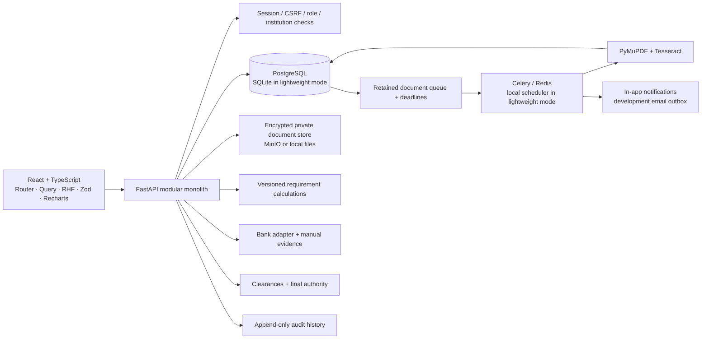

# Architecture

The application is a modular monolith: a single FastAPI deployment owns authentication, record access, database transactions and financial-workflow decisions. Background extraction and monitoring reuse those modules. The frontend contains no independent source of truth for approvals or deposit data.

## Modules

- `auth_routes.py` and `security.py`: session issuance/revocation, password hashing, CSRF and record access.
- `deposit_routes.py`: institutions, requirement requests, drafts, submissions, documents, corrections and replacements.
- `rules.py`: calculation against approved effective-dated versions. The calculated result is snapshotted on the deposit.
- `storage.py`: content validation, optional ClamAV INSTREAM, private object storage and encryption.
- `extraction.py`, `extraction_engine.py`, `jobs.py`, `worker.py`: text extraction, OCR fallback, provider provenance, durable claims/retries and scheduling. Trained VLM integration is deferred; OCR remains the active default.
- `workflows.py`: discrepancy generation, reminders and release-blocker evaluation.
- `bank.py`: adapter protocol and deterministic fictional bank fixture lookup.
- `review_routes.py`: assignment, scrutiny, discrepancy handling, bank evidence and release decisions.
- `admin_routes.py`: authorised reports, rule proposals/approvals, user management, configuration and monitoring.
- `audit.py`: actor-attributed events and per-entity hash chaining.

## Evidence boundaries

Institution declarations live on `deposit_instruments`. Original PDF/image bytes live in the encrypted object store. Parser text and fields live in `document_extractions`. Corrections are append-only records in `field_corrections`; they never replace original extracted evidence. Applicable requirements are copied into `security_deposits.requirement_snapshot`. Bank findings live in verification requests/evidence with a mandatory simulation distinction.

The UI compares these categories and identifies missing information. It never equates OCR success with independent confirmation, or an automated anomaly with proven fraud.

## State and transactions

Cases progress through `draft`, `submitted`, `under_review`, `clarification_required`, `release_requested`, `release_authorised`, `released`. Instrument state (`active`, `replaced`, `discharged`) and verification state (`pending`, `mock_confirmed`, `officially_confirmed`, etc.) are separate.

Draft submission requires an uploaded receipt. Submitted financial details can only change after an officer requests clarification; a change resets bank verification. Replacements retain the earlier instrument and require a new receipt before resubmission. An existing release workflow blocks replacement, preventing approval against a silently changed instrument.

Release requests snapshot required documents and clearance cells. Their blockers include unresolved discrepancies, missing permitted verification, an uncompleted/unestablished regulatory period, missing supporting documents, in-progress instrument extraction, and missing or nonapproved clearances. Each clearance officer is limited to their assigned cell. Only an approving authority can authorise or record completion; prior case reviewers are excluded from the final decision even after reassignment. The server rechecks prerequisites; frontend buttons cannot bypass the checks. Authorised cases reject new financial evidence mutations.

PostgreSQL mutation paths lock deposit records. SQLite mode is designed for one local application process, not multiworker deployment.

## Scheduling

Document status is durably recorded as `queued`, `processing`, `completed` or `failed`. Local background execution handles uploads promptly; a five-second scheduler sweep recovers queued work and expired claims. Attempt limits and backoff bound retries, while claim tokens prevent late results from overwriting a new claim. Inference runs outside a database transaction and is limited to one extraction per process. Failed extractions expose a generic actionable message and an explicit retry operation. Celery deployments use late acknowledgements, one worker process by default and a five-minute recovery/monitoring beat job.

Deadline monitoring covers bank maturity, validity, renewal actions and regulatory dates. Idempotency keys include instrument, deadline type, exact date and reminder stage; overdue escalations use interval buckets. A missed scheduled day generates the currently relevant reminder on the next run. In-app and simulated email delivery use the same retained notification; read state is per user.

## Security

- Password hashes use Argon2. Session cookies hold random opaque tokens; only hashes are stored in the database. Sessions expire after eight hours and are revoked on logout/password changes or disabled-account access.
- HttpOnly session cookies, SameSite=Lax, server-bound CSRF tokens for mutations, exact-origin validation and no localStorage credentials.
- Central deposit scoping applies to detail, mutation, document access and related workflows. Institution queries and exports are restricted to their institution.
- Role permissions are enforced server-side. Verification requires officer assignment; clearance decisions require the matching cell. Rule proposals require a different administrator's approval.
- Uploads enforce size, actual format and extension, PDF page limits, encrypted/active PDF restrictions and image pixel limits. OCR has timeouts and raster-size limits. ClamAV is optional locally and mandatory in production settings.
- Documents are encrypted with Fernet before either local or S3 storage. Local objects use opaque generated keys and restricted permissions. Bucket setup explicitly disables anonymous access.
- Document grants expire in two minutes, require the original signed-in user, and recheck record access. Access logs for document token URLs are disabled in the supplied server configuration.
- Audit updates/deletes are blocked by application listeners and migration-installed database triggers. Per-entity chain heads serialize appends in the same transaction; hashes and head comparisons allow integrity checks. This is not a guarantee against a privileged database administrator rebuilding an entire history.
- Production settings require explicit keys, secure cookies and malware scanning. TLS must terminate at a trusted reverse proxy; encryption-at-rest for the relational database/volumes and managed secret rotation remain deployment responsibilities.
- CSV values are escaped against spreadsheet formula injection. React escapes text; the UI does not inject document HTML.

## Deployment distinction

The native mode intentionally avoids Docker, Redis and MinIO to reduce local resource use. PostgreSQL schema, SQLAlchemy models, Alembic migrations, private S3 adapter, Celery workers and Compose service definitions remain included. They are separate supported configurations, not a claim that the optional stack has been exercised on this machine.
