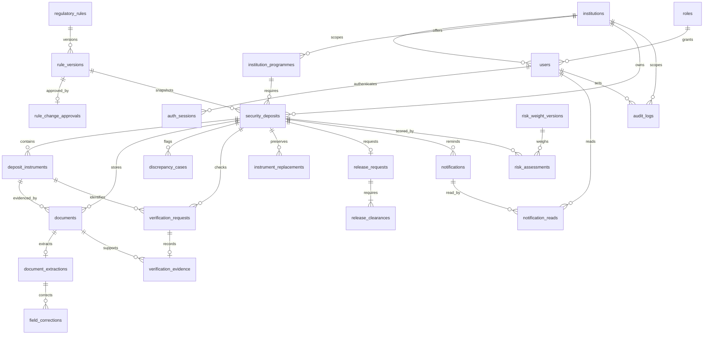

# Database relationships

Identifiers are UUIDs (`UUID` on PostgreSQL; portable UUID representation on SQLite). Money uses fixed precision `NUMERIC(16,2)`. Dates are separate from UTC event timestamps. Foreign keys, unique references, positive-amount/date checks and operational indexes are present in the initial Alembic migration.

`configuration` stores current workflow and alert settings. Release requests copy the workflow configuration at creation, so later edits do not reduce existing prerequisites. `mock_bank_records` is an explicitly fictional test dataset, not an external authority.

Important constraints:

- A bank name plus instrument reference is unique after normalisation.
- A document has one immutable original extraction; multiple corrections are retained separately.
- Instrument replacements have unique predecessor/successor references.
- Each deposit has at most one release workflow. Returned requests can be corrected and resubmitted; rejected requests require administrative follow-up outside this prototype.
- Each release has one row per required clearance cell.
- Notification deduplication is enforced by a unique key; user read state is a separate composite-key table.
- Audit logs have database triggers that reject updates and deletes, including raw SQL.
- `audit_chain_heads` stores the latest hash and timestamp per entity to serialize concurrent audit appends. It is checked against the event history by system monitoring.
- Document extraction attempts retain processing claims, start times and retry deadlines. Original extraction records retain provider and checksum provenance.

The reviewed SQLAlchemy model is in `backend/app/models.py`. The initial migration contains concrete table definitions, rather than depending on a mutable `create_all` during application startup. `docs/schema.postgresql.sql` is generated by Alembic offline compilation; it has not been executed against a live PostgreSQL server in this local session.
